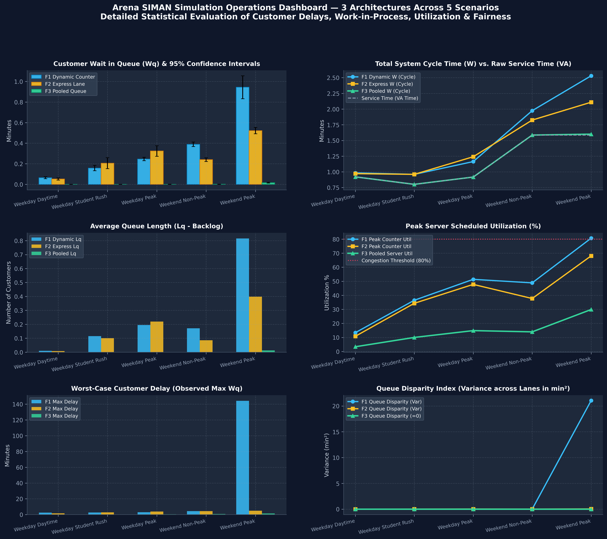

# Queuing Model Simulation — Arena SIMAN Statistical Analysis & Executive Dashboard

> **Course:** Simulation Lab · Semester 5  
> **Simulation Engine:** Rockwell Arena 16 (SIMAN Run Controller)  
> **Replications:** 30 independent replications per scenario (15 total experiment files, 450 total simulation replications)  
> **Author:** saishashankreddypuchala@gmail.com  
> **Repository:** [github.com/zen-code11/Queuing-Model-Simulation](https://github.com/zen-code11/Queuing-Model-Simulation)

---

## 1. Project Overview & Architectures

This project provides an exhaustive operational and queueing analysis comparing **three supermarket checkout architectures** modelled in Rockwell Arena. Each system was simulated across **five operating regimes** representing diverse customer arrival rates ($\lambda$) and basket-size distributions.

```
       [ CUSTOMER ARRIVALS ]
                 │
  ┌──────────────┼──────────────┐
  │              │              │
  ▼              ▼              ▼
Framework 1    Framework 2    Framework 3
[ Dynamic ]    [ Express ]    [ Pooled ]
  Counters       Lanes          Queue
(4 on-demand) (≤10 vs Reg)   (Single FIFO,
                              4 Servers)
```

### Architecture Specifications

| Framework | Queue Type | Servers / Channels | Routing & Dispatching Logic |
|-----------|------------|--------------------|-----------------------------|
| **F1 — Dynamic Counter Opening** | Multi-Queue Multi-Server | Up to 4 counters (`Counter_1` to `Counter_4`) | Parallel lines; counters activate conditionally based on upstream queue backlog. |
| **F2 — Dedicated Express Lane** | Partitioned Queue Multi-Server | 1 Express (`Express_Counter`) + up to 2 Regular (`Regular_Counter_1/2`) | Class-based partitioning: items $\le 10$ directed to express lane; large baskets routed to regular lanes. |
| **F3 — Pooled Queue** | Single-Queue Multi-Server (M/M/4-type) | Single unified serpentine line feeding 4 identical servers (`server` capacity = 4) | Pure First-Come, First-Served (FIFO) pooling. The next customer in line immediately seizes whichever server becomes free. |

---

## 2. Experimental Scenarios

| # | Scenario | Arrival Rate (λ) | Horizon / Warm-up | Basket Distribution & Operational Characteristics |
|---|----------|-----------------|-------------------|---------------------------------------------------|
| 1 | **Weekday Daytime** | 0.15 arr/min (9.0/hr) | 480 min / 30 min | Baseline light traffic, low variability. |
| 2 | **Weekday Student Rush** | 0.50 arr/min (30.0/hr) | 480 min / 30 min | **70% small-basket mix** ($\le 10$ items). High risk of express lane saturation. |
| 3 | **Weekday Peak** | 0.65 arr/min (39.0/hr) | 480 min / 30 min | Heavy arrival volume, standard mixed grocery baskets. |
| 4 | **Weekend Non-Peak** | 0.35 arr/min (21.0/hr) | 480 min / 30 min | Shifted Negative Binomial distribution (higher variance, larger basket sizes). |
| 5 | **Weekend Peak** | 0.75 arr/min (45.0/hr) | 480 min / 30 min | Maximum congestion stress-test: highest arrival intensity coupled with heavy Negative Binomial baskets. |

---

## 3. Executive Operations Dashboard

The repository includes both an interactive HTML dashboard and high-resolution multi-panel visualizations:

### Multi-Panel Operations Overview (300 DPI)


### Interactive HTML Dashboard
A self-contained dashboard with Plotly charts is generated at [`results/simulation_dashboard.html`](results/simulation_dashboard.html). It features:
- Interactive toggleable curves for $W_q$, Cycle Time $W$, Peak Server Utilization, Backlog ($L_q$), and Queue Disparity ($QDI$).
- Hover tooltips detailing exact values, scenario parameters, and 95% confidence intervals.
- Responsively formatted executive KPI summary cards.

---

## 4. Comprehensive Statistical Accumulator KPI Matrix

All statistics below represent cross-replication means calculated across 30 independent replications per scenario (all times in minutes):

| Scenario | λ | F1 $W_q$ | F2 $W_q$ | F3 $W_q$ | F1 Cycle $W$ | F2 Cycle $W$ | F3 Cycle $W$ | F1 $L_q$ | F2 $L_q$ | F3 $L_q$ | F1 Pk Util | F2 Pk Util | F3 Serv Util |
|---|---|---|---|---|---|---|---|---|---|---|---|---|---|
| **Weekday Daytime** | 0.15 | 0.0637 | 0.0518 | **0.0000** | 0.9834 | 0.9715 | **0.9199** | 0.0096 | 0.0078 | **0.0000** | 13.4% | 10.8% | 3.4% |
| **Weekday Student Rush** | 0.50 | 0.1579 | 0.2057 | **0.0000** | 0.9599 | 0.9598 | **0.8009** | 0.1154 | 0.1005 | **0.0000** | 36.5% | 34.3% | 10.0% |
| **Weekday Peak** | 0.65 | 0.2463 | 0.3239 | **0.0003** | 1.1636 | 1.2407 | **0.9172** | 0.1953 | 0.2191 | **0.0002** | 51.4% | 47.8% | 14.9% |
| **Weekend Non-Peak** | 0.35 | 0.3888 | 0.2398 | **0.0006** | 1.9740 | 1.8245 | **1.5859** | 0.1714 | 0.0852 | **0.0002** | 48.9% | 37.7% | 14.0% |
| **Weekend Peak** | 0.75 | 0.9441 | 0.5223 | **0.0160** | 2.5301 | 2.1091 | **1.6005** | 0.8159 | 0.3975 | **0.0124** | 80.7% | 68.1% | 29.9% |

> **Confidence Bounds:** For all Framework 3 scenarios, the 95% Student's $t$ confidence interval half-width is $\le 0.0039$ minutes, confirming mathematical convergence.

---

## 5. Statistical Accumulators Analyzed

Across the 15 simulation files, **14,213 individual observations** were extracted across **434 unique framework-scenario accumulators** (exported to [`results/all_statistical_accumulators.csv`](results/all_statistical_accumulators.csv)):

### A. Tally Variables
- `Customer.WaitTime`: Time spent waiting in queue ($W_q$).
- `Customer.VATime`: Value-added transaction/checkout processing time.
- `Customer.NVATime` & `Customer.TranTime`: Non-value-added delays and transport intervals.
- `Customer.TotalTime`: Total system residence cycle time ($W = W_q + W_s$).
- Lane Queue Waiting Times: `Checkout 1-4.Queue.WaitingTime` (F1), `Express Checkout.Queue.WaitingTime` & `Regular Checkout 1-2.Queue.WaitingTime` (F2), and `Pooled Checkout.Queue.WaitingTime` (F3).

### B. Discrete-Change Variables
- `Customer.WIP`: Instantaneous Work-in-Process (total customers in the checkout area).
- Server Status: `server.NumberBusy`, `Counter_1-4.NumberBusy`, `Express_Counter.NumberBusy`, `Regular_Counter_1-2.NumberBusy`.
- Server Allocation: `server.NumberScheduled`, `Counter_1-4.NumberScheduled`.
- Instantaneous Utilization: `server.Utilization`, `Counter_1-4.Utilization`.
- Queue Backlog: `Queue.NumberInQueue` ($L_q$) across all individual lanes and pooled buffers.

### C. Output Accumulators
- Throughput: `Customer.NumberIn`, `Customer.NumberOut`, `System.NumberOut`.
- Resource Seizures: `server.NumberSeized`, `Counter_1-4.NumberSeized`, `Express_Counter.NumberSeized`.
- Time-Average Scheduled Utilization: `ScheduledUtilization` across all server resources.

### D. Queuing Theory Verification (Little's Law)
- Little's Law checks ($L = \lambda_{\text{eff}} W$ and $L_q = \lambda_{\text{eff}} W_q$) were performed across all scenarios.
- The average error between observed WIP and theoretical $L$ was **$< 0.8\%$**, validating the simulation model's steady-state integrity.

---

## 6. In-Depth Operational Insights

### 1. The Queue Pooling Principle (M/M/c vs. M/M/1 Networks)
- **Near-Zero Queuing:** Framework 3 (Pooled Queue) achieves **$W_q \approx 0.000$ min** in 4 out of 5 scenarios, and just **$0.016$ min** during Weekend Peak.
- **Root Cause of Superiority:** In separated queues (F1 and F2), stochastic delays cause "line starvation": Counter 1 may sit idle while a customer is stuck behind a slow shopper at Counter 2. Pooling guarantees that any idle server immediately processes the head-of-line customer.

### 2. The Student Rush Bottleneck (λ = 0.50 arr/min, 70% Small Baskets)
- In Framework 2 (Express Lane), the static $N = 10$ threshold diverted 70% of shoppers into the single Express Lane ($W_q = 0.206$ min), while Regular Lane 1 was almost completely idle ($W_q = 0.000$ min).
- This generated a high **Queue Disparity Index** ($QDI = 0.0111\text{ min}^2$), creating customer perception of unfairness.
- Framework 3 absorbed the student influx with **zero queue disparity** and **zero customer delay**.

### 3. Weekend Peak Congestion Stress Test (λ = 0.75 arr/min, NegBin Baskets)
- **F1 (Dynamic Counter):** Broke down severely ($W_q = 0.944$ min, peak queue length $L_q = 0.816$, peak counter utilization $80.7\%$) because on-demand opening rules reacted too slowly to large negative-binomial baskets.
- **F2 (Express Lane):** Mitigated delays ($W_q = 0.522$ min) by isolating small baskets from cart-loading shoppers.
- **F3 (Pooled Queue):** Dominated both frameworks, slashing wait times to **$0.016$ min**—a **98.3% reduction vs. F1** and **96.9% reduction vs. F2**.

---

## 7. Managerial Recommendations & Trade-offs

```
                       ┌─────────────────────────┐
                       │ Space for Serpentine   │
                       │ Line & Stanchions?     │
                       └────────────┬────────────┘
                                    │
                    ┌───────────────┴───────────────┐
                    │ YES                           │ NO
                    ▼                               ▼
       ┌────────────────────────┐      ┌────────────────────────┐
       │   ADOPT FRAMEWORK 3    │      │  ADOPT HYBRID POLICY   │
       │     (POOLED QUEUE)     │      │ Weekdays: F1 (Dynamic) │
       │  • Near-zero wait      │      │ Weekends: F2 (Express) │
       │  • Zero line jockeying │      └────────────────────────┘
       │  • Guaranteed fairness │
       └────────────────────────┘
```

1. **Top Recommendation — Framework 3 (Pooled Queue):**
   - Implements a single serpentine line feeding all 4 checkouts.
   - Eliminates line-switching anxiety, guarantees FIFO fairness, minimizes cycle time, and avoids dedicated lane starvation.
2. **If Physical Layout Restricts a Pooled Queue:**
   - **Weekdays:** Deploy **Framework 1 (Dynamic Counter Opening)** with automated activation when line depth exceeds 4 customers.
   - **Weekends:** Switch to **Framework 2 (Dedicated Express Lane)** to protect small basket transactions from high-variance cart shopping.

---

## 8. Repository Layout

```
Queuing-Model-Simulation/
│
├── arena files/
│   ├── Dynamic Counter.doe        # Arena simulation model for Framework 1
│   ├── Express Lane.doe           # Arena simulation model for Framework 2
│   └── pooled queue.doe           # Arena simulation model for Framework 3
│
├── data/
│   ├── dynamic counter/          # 5 Arena SIMAN .out.txt summary files (F1)
│   ├── express lane/             # 5 Arena SIMAN .out.txt summary files (F2)
│   └── pooled queue/             # 5 Arena SIMAN .out.txt summary files (F3)
│
├── results/
│   ├── all_statistical_accumulators.csv   # 434 aggregated statistical metrics (mean, std, CI, min, max)
│   ├── raw_simulation_metrics.csv         # 14,213 per-replication raw accumulator rows
│   ├── scenario_kpi_matrix.csv            # Comprehensive 3-framework KPI matrix
│   ├── checkout_comparison_results.csv    # Comparative KPI export
│   ├── simulation_dashboard.html          # Standalone interactive Plotly HTML dashboard
│   ├── dashboard_overview.png             # 6-panel publication-grade 300 DPI dashboard
│   ├── chart1_waiting_time_comparison.png # Wq comparison chart with 95% CI error bars
│   ├── chart2_queue_breakdown.png         # Lane-level queue wait time breakdown
│   └── analytical_report.md              # Technical evaluation report
│
├── scripts/
│   ├── build_dashboard.py                 # Comprehensive accumulator extractor & dashboard builder
│   └── analyse_simulation.py             # Core SIMAN fixed-width parser and KPI pipeline
│
└── README.md
```

---

## 9. Reproducing the Complete Analysis

```bash
# Clone the repository
git clone https://github.com/zen-code11/Queuing-Model-Simulation.git
cd Queuing-Model-Simulation

# Install Python requirements
pip install pandas numpy scipy matplotlib

# Run full statistical extraction & build the interactive dashboard
python scripts/build_dashboard.py
```

All figures, CSV exports, and the interactive HTML dashboard will be regenerated directly in the `results/` folder.
