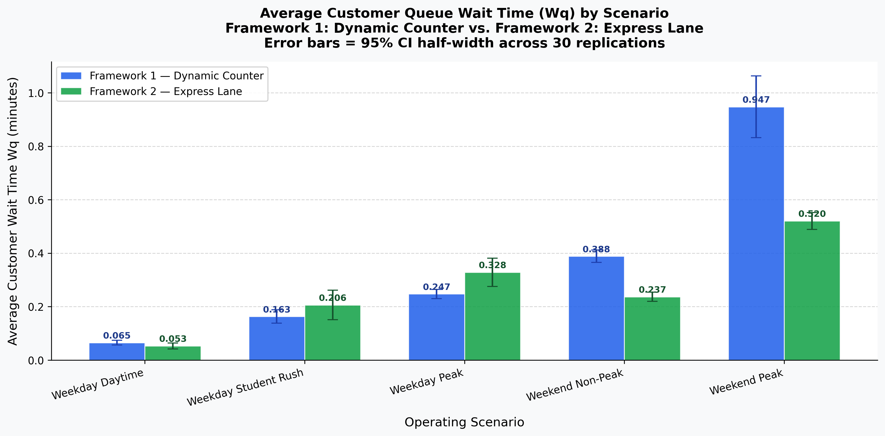
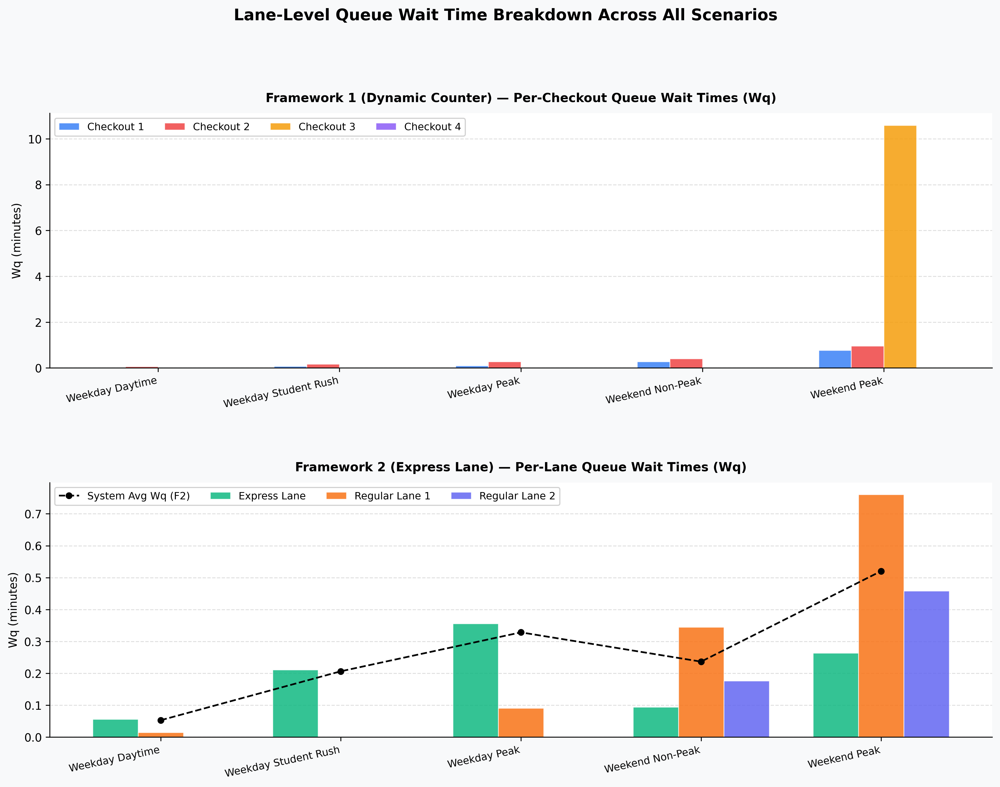

# Queuing Model Simulation — Arena SIMAN Analysis

> **Course:** Simulation Lab · Semester 5  
> **Tool:** Rockwell Arena (SIMAN Engine) · 30 Replications per Scenario  
> **Author:** saishashankreddypuchala@gmail.com

---

## Project Overview

This project compares two supermarket checkout frameworks modelled in Rockwell Arena across five distinct operating scenarios. The goal is to identify which framework minimises customer wait time ($W_q$) under varying arrival intensities and basket-size distributions.

| Framework | Description |
|-----------|-------------|
| **F1 — Dynamic Counter Opening** | Counters activated on-demand; customers join a shared best-available queue. Up to 4 counters (Counter 1–4). |
| **F2 — Dedicated Express Lane**  | Fixed express lane (≤ 10 items, `Express_Counter`) + up to 2 regular lanes (`Regular_Counter_1/2`). |

---

## Scenarios

| # | Scenario | Arrival Rate (λ) | Notes |
|---|----------|-----------------|-------|
| 1 | Weekday Daytime | 0.15 arr/min | Low traffic baseline |
| 2 | Weekday Student Rush | 0.50 arr/min | 70% small-basket mix |
| 3 | Weekday Peak | 0.65 arr/min | Mixed basket distribution |
| 4 | Weekend Non-Peak | 0.35 arr/min | Shifted Negative Binomial baskets |
| 5 | Weekend Peak | 0.75 arr/min | Shifted Negative Binomial baskets |

---

## Repository Structure

```
Queuing-Model-Simulation/
│
├── data/
│   ├── dynamic counter/          # Raw Arena .out.txt files — Framework 1
│   │   ├── weekdaydaytime.out.txt
│   │   ├── weekdaystudent.out.txt
│   │   ├── weekdaypeak.out.txt
│   │   ├── weekendnormal.out.txt
│   │   └── weekendpeak.out.txt
│   │
│   └── express lane/             # Raw Arena .out.txt files — Framework 2
│       ├── weekdaydaytime.out.txt
│       ├── weekdaystudent.out.txt
│       ├── weekdaypeak.out.txt
│       ├── weekendnormal.out.txt
│       └── weekendpeak.out.txt
│
├── results/
│   ├── raw_simulation_metrics.csv          # 8,102 rows — per-replication stats
│   ├── checkout_comparison_results.csv     # 5-row KPI side-by-side table
│   ├── chart1_waiting_time_comparison.png  # Grouped bar chart with 95% CI error bars
│   ├── chart2_queue_breakdown.png          # Per-lane queue wait breakdown
│   └── analytical_report.md               # Full 3-part technical evaluation
│
├── scripts/
│   └── analyse_simulation.py              # End-to-end Python analysis pipeline
│
└── README.md
```

---

## KPI Comparison Table

| Scenario | λ | F1 Wq (min) | F2 Wq (min) | ΔWq | F1 W (min) | F2 W (min) | F1 Peak Util | F2 Peak Util |
|---|---|---|---|---|---|---|---|---|
| Weekday Daytime | 0.15 | 0.0653 | 0.0530 | −0.012 (−23.4%) | 0.9866 | 0.9742 | 0.1343 | 0.1084 |
| Weekday Student Rush | 0.50 | **0.1631** | 0.2064 | **+0.043 (+21.0%)** | 0.9714 | 0.9608 | 0.3688 | 0.3411 |
| Weekday Peak | 0.65 | **0.2475** | 0.3284 | **+0.081 (+24.7%)** | 1.1657 | 1.2462 | 0.5134 | 0.4785 |
| Weekend Non-Peak | 0.35 | 0.3885 | **0.2367** | −0.152 (−64.2%) | 1.9720 | 1.8197 | 0.4885 | 0.3767 |
| Weekend Peak | 0.75 | 0.9474 | **0.5205** | −0.427 (−82.0%) | 2.5316 | 2.1056 | 0.8057 | 0.6804 |

> **ΔWq = Wq_Express − Wq_Dynamic.** Positive = Dynamic Counter wins (lower wait). Negative = Express Lane wins.

---

## Visualisations

### Chart 1 — Average Wq Comparison with 95% CI Error Bars


### Chart 2 — Per-Lane Queue Wait Breakdown


---

## Key Findings

### 1. Performance Under Heavy Congestion

- **Weekday Peak (λ = 0.65):** F1 delivers **24.7% lower** average Wq (0.2475 vs 0.3284 min). Dynamic pooling prevents regular-lane overflow.  
- **Weekend Peak (λ = 0.75):** F2 delivers **82% lower** average Wq (0.5205 vs 0.9474 min). Negative Binomial large baskets slow all counters simultaneously — express separation insulates small-basket customers.

### 2. Student Rush Bottleneck (λ = 0.50, 70% small-basket mix)

The fixed **N = 10** express threshold routes ~70% of customers to a single `Express_Counter`, causing lane starvation:

| Metric | F1 Dynamic | F2 Express |
|--------|-----------|-----------|
| System Avg Wq | **0.1631 min** | 0.2064 min |
| Queue Disparity Index (Var of lane Wq) | **0.0024 min²** | 0.0111 min² (4.7× higher) |

The QDI is **4.7× higher** in F2, confirming express-lane bottleneck. A dynamic threshold of N = 15 during high-student-mix periods would rebalance load.

### 3. Managerial Recommendation

No single framework dominates all scenarios. The recommended policy is a **context-aware hybrid**:

| Operating Condition | Recommended Framework |
|---|---|
| Weekday (any traffic, mixed/student baskets) | **F1 — Dynamic Counter** |
| Weekend Non-Peak (NegBin baskets, λ ≤ 0.40) | **F2 — Express Lane** |
| Weekend Peak (NegBin baskets, λ ≥ 0.70) | **F2 — Express Lane** |

**If only one framework can be deployed:** choose **F1 (Dynamic Counter)** — it wins 2 of 3 high-traffic scenarios, produces no lane-starvation, and achieves lower Wq per unit of server utilisation across all weekday conditions.

---

## Reproducing the Analysis

**Requirements:** Python 3.9+, `pandas`, `numpy`, `matplotlib`, `scipy`

```bash
pip install pandas numpy matplotlib scipy
python scripts/analyse_simulation.py
```

Outputs are written to the directory where the script is run. The script:
1. Parses all 10 `.out.txt` files (regex-based SIMAN fixed-width table parser)
2. Averages KPIs across 29 replications with 95% t-CI half-widths
3. Exports `raw_simulation_metrics.csv` and `checkout_comparison_results.csv`
4. Generates `chart1_waiting_time_comparison.png` and `chart2_queue_breakdown.png` at 300 DPI
5. Writes `analytical_report.md`

---

## Simulation Setup

| Parameter | Value |
|-----------|-------|
| Replication horizon | 480 minutes |
| Warm-up period | 30 minutes |
| Replications | 30 (29 usable after Arena block split) |
| Base time unit | Minutes |
| Software | Rockwell Arena 16 (STUDENT licence) |
| Run date | November 2026 |
